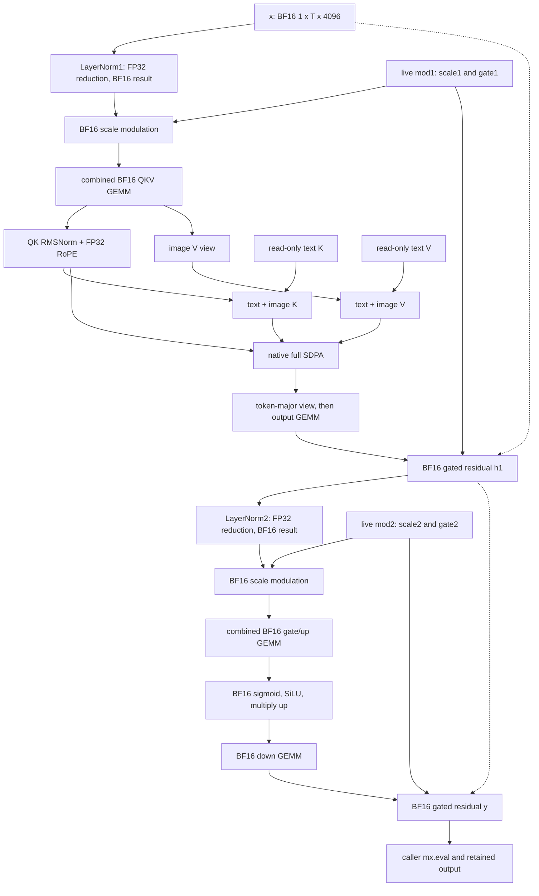

# Block0 dataflow and ownership

Author: Astra, Codex relay, 2026-10-12, turn beginning 22:41:20 UTC. CPU source reading only. This map describes the selected fc09 source, commit `9a8e722a0059d2de4447037246def05e56f69c47`, against native mflux `f0bf9cf0506a2ae15115af1c72e3dc0093e41597`. MLX reference source is v0.32.3, commit `64ea011cb65f14d9ce2737e60db9a4ae91ed7441`. Sources and personal reading ranges are in [MEGAKERNEL-SOURCES.md](../research/MEGAKERNEL-SOURCES.md).

This is a source-derived graph, not a trace. Kernel counts, memory traffic, residency, host gaps and per-operation time have not been measured. The source kit positively matches eight installed steel headers, but does not establish the compiled wheel's identity with the C++ source. Conditional source conclusions below retain that limit.

## Finding that changes the next decision

Pinned full-attention SDPA returns shape `[B,H,T,D]` with element strides `[T*H*D,D,H*D,1]`, not row-contiguous `[H*T*D,T*D,D,1]`. See `scaled_dot_product_attention.cpp:1023-1052`. With this task's dimensions, the strides are `[4096*T,128,4096,1]`. Both the NAX and steel routes receive this allocated output and its strides. The separate vector-attention route does not apply to T=1024 or 2304.

Consequently, fc09's `transpose(0,2,1,3)` produces a physically row-contiguous `[1,T,32,128]` view. Collapsing the last two dimensions to `[1,T,4096]` requires no data reorder on this source path. The claim that this necessarily creates a layout copy is unsupported.

The unsubmitted fc13 source passes the untransposed SDPA array to a custom kernel with the default `ensure_row_contiguous=True`. Its head-major address map then expects `[head,token,channel]` storage. The pinned custom-kernel implementation copies any input lacking the row-contiguous flag before dispatch. Thus this source combination predicts an **added** token-major to head-major copy, followed by correctly addressed head-major reads. It does not predict removal of an existing copy. This is a source-level counterexample to fc13's proposed mechanism, not a measured regression or a correctness failure.

Do not repair fc13 by merely disabling `ensure_row_contiguous`: its existing address map would then read token-major storage as head-major. Keep the proposal untouched under the research pause. Root should review this finding before any future fc13 admission. The smallest missing evidence is trusted observation of the installed path's evaluated strides and copy dispatches, under a separately authorized diagnostic. No such probe ran this turn.

## Scope and live state

Let H=32, D=128, C=4096, F=12288, T in {1024,2304}, L in {128,512}, and S=T+L. All strides below count elements. Singleton batch strides do not affect addresses; formulas show a compatible canonical stride. BF16 uses two bytes; FP32 uses four.

The timed boundary is `run(x,k,v,mod1,mod2,cos,sin)` through the judge's `mx.eval(output)`. Allocation, required copies and input-dependent work belong inside it. Setup may prepare weights, but may not prepare answers or retain input-derived results across calls. No text forward, scheduler, VAE, 32-layer rollout or cross-step KV update belongs to this boundary.

| Object | Shape and dtype | Layout and owner | Creation, last use and reuse rule |
|---|---|---|---|
| Hidden input x | `[1,T,C]`, BF16 | Caller-owned, row-contiguous, strides `[T*C,C,1]` | Ready before call. Read by first norm and first residual. Never overwrite, even after those uses. New calls may change its values. |
| Cached text k,v | Each `[1,H,L,D]`, BF16 | Caller-owned, contiguous, strides `[H*L*D,L*D,D,1]` | Ready before call; copied/consumed into joined KV. Read-only. No cache write or prompt computation here. Do not assume identity or values persist between calls. |
| mod1,mod2 | Each `[1,T,2*C]`, BF16 | Caller-owned broadcast views of `[1,1,2*C]`; token stride zero, channel stride one | Ready before call. Split views expose scale and gate. Scale1 ends at first modulation, gate1 at first residual, scale2 at second modulation, gate2 at final residual. Their values are live per call; zero stride permits per-token reuse only within that call. |
| cos,sin | Each `[T,D/2]`, FP32 | Caller-owned, contiguous, strides `[64,1]` | Ready before call; consumed by QK RoPE. Immutable and live inputs. |
| Original checkpoint tensors | Seven Q4 projections, their affine scales/biases, two BF16 norm weights `[D]` | Shared read-only tensor objects across native/candidate containers under v4 | Prepared by trusted setup; immutable through candidate setup, correctness and timing. Checkpoint container is 122,686,160 bytes per manifest. |
| Private fc09 BF16 weights | QKV `[3*C,C]`, output `[C,C]`, gate/up `[2*F,C]`, down `[C,F]` | Candidate closure, dense NT matrices | Created once in `create`; FP32 affine decode followed by BF16 cast and setup `mx.eval`. Concatenation temporaries lose Python references after evaluation. Reuse for all calls using this fixed block. Released with callable, subject to runtime retention. |
| Final output y | `[1,T,C]`, BF16 | New logical result for each call, owned by caller after return | Judge completes it with `mx.eval`. Prior returned outputs remain valid across later calls. No reusable singleton output buffer may overwrite them. |

The candidate's persistent private weight payload is 436,207,616 bytes, or 416 MiB, computed from matrix shapes: QKV 96 MiB, output 32 MiB, gate/up 192 MiB, down 96 MiB. This excludes shared originals, allocator caches, compilation state, temporary preparation matrices and live activations. It is not an RSS or simultaneous-residency measurement.

## Execution graph

Boxes denote logical operations, not measured GPU dispatches. Dashed residual edges explain why x and h1 must remain available after their normalization consumers.

RoPE also reads cos/sin and the immutable norm weights. Every GEMM reads its prepared weight. Those edges are omitted only to keep the drawing readable.

## Per-call tensor map for fc09

Each row starts when its producer executes and ends logically at its last consumer. Buffer reuse or deallocation can occur later; source-level last use is not observed device completion. `A = 2*T*C` bytes is 8 MiB at T=1024 and 18 MiB at T=2304.

| Tensor or region | Producer, shape and numerical seam | Physical layout / last consumer |
|---|---|---|
| scale1,gate1,scale2,gate2 | Split live modulation into `[1,T,C]` BF16 views | Channel stride one, token stride zero, second half offset C. No token-axis replication required by ABI. Consumers are the respective modulation/residual functions. |
| norm1 | Native fast LayerNorm over C, eps=1e-6. FP32 mean and centered variance; normalized result narrows to BF16. `[1,T,C]`, A bytes | Input is contiguous. Source permits buffer donation only when runtime ownership allows it; x remains externally live and is also a residual input. Last consumer is `_modulate`. |
| attn_input | `_modulate(norm1,scale1)`, `[1,T,C]` BF16 | `1+scale1` and the multiplication have BF16 graph outputs. Compiled elementwise graph may keep these intermediates in registers. Materialized result feeds QKV GEMM only. |
| qkv | Custom GEMM, `[1,T,3*C]` BF16, 3A bytes | Dense token-major strides `[T*3*C,3*C,1]`. FP32 accumulators narrow at GEMM store. Split q,k,v are views of this one allocation, each offset by C. |
| q_flat,k_flat,v_flat | Each `[1,T,C]` BF16 | Token stride 3C, channel stride one. Q and K feed the prologue. V remains a view until joined-V consumption, so finishing QK alone does not release qkv storage. |
| query,key_image on fused route | RMSNorm each 128-channel head plus RoPE; each `[1,H,T,D]` BF16, A bytes | Fused helper reads original projection strides and writes dense head-major strides `[H*T*D,T*D,D,1]`. BF16 norm weights in manifest keep promoted output BF16. Query lasts through SDPA; key_image through joined-K production. |
| QK numerical seam | FP32 sum of squares and precise reciprocal square root; normalized x narrows to BF16, weighted result narrows again; FP32 rotary products then add/subtract, final BF16 store | Fused source disables FP contraction for rotary arithmetic. Changing this ordering is a numerical risk even when formulas are algebraically equal. |
| QK composed route | Used if helper unavailable or norm eps differs. Reshape, native RMSNorm, `_apply_rope`, transpose | Logical output shapes match fused route; physical strides/copies may differ. The actual selected branch was not profiled. Do not claim fusion availability from shape alone. |
| value_image | Reshape v_flat to `[1,T,H,D]`, transpose to `[1,H,T,D]`, BF16 | A view can retain head stride D and token stride 3C. Last consumer is joined-V production. It is not a dense head-major allocation simply because its shape is head-major. |
| key_join,value_join | Separate concatenations `[text,image]` along token axis; each `[1,H,S,D]` BF16 | New logical joined arrays feed SDPA. Exact concat allocator strategy was not read; dense head-major is the expected output, not a measured stride receipt. Last dimension stays channel-contiguous on the intended path. Text inputs remain immutable. |
| SDPA internal scores and accumulators | Full noncausal attention, scale `128**-0.5`, no mask/sinks. Conceptual score shape `[1,H,T,S]` | Steel source keeps score tiles, running row maximum/sum and output accumulators in FP32, loops over KV tiles, then narrows output to BF16. It does not materialize the full conceptual score matrix on that fused path. Actual installed route is untraced. |
| SDPA output | `[1,H,T,D]` BF16, A bytes | Pinned full-attention allocation is token-major physical order with strides `[T*C,D,C,1]`. Last consumer is output projection. It is not row-contiguous in its logical shape. |
| flattened attention | Transpose SDPA to `[1,T,H,D]`, reshape to `[1,T,C]` | Compatible strides become `[T*C,C,D,1]`, then `[T*C,C,1]`. This is a view on the pinned output allocation, not an additional A-byte copy. |
| projected attention | Custom NT GEMM `[1,T,C]` BF16, A bytes | FP32 accumulator followed by BF16 output seam. Last consumer is first `_gated_residual`. |
| h1 | `x + tanh(gate1)*projected_attention`, `[1,T,C]` BF16, A bytes | Compiled graph retains typed BF16 nodes for tanh, product and add. h1 has two later consumers: norm2 and final residual. It must survive the entire MLP. |
| norm2,mlp_input | Same normalization and modulation seams as norm1/attn_input, each `[1,T,C]` BF16 | norm2 ends at modulation; mlp_input ends at gate/up GEMM. h1 cannot be discarded at norm2 completion. |
| gate_up | Custom NT GEMM `[1,T,2*F]` BF16, 6A bytes | Dense token-major. Split gate/up `[1,T,F]` views have token stride 2F, channel stride one, offsets 0/F. Both feed `_swiglu`; split does not create two independent dense allocations. |
| swiglu | `gate * sigmoid(gate) * up`, `[1,T,F]` BF16, 3A bytes | Installed `nn.silu` is already compiled and returns `x*sigmoid(x)`. fc09 compiles the surrounding multiply too. Sigmoid, SiLU product and up product preserve their BF16 graph results. Last consumer is down GEMM. |
| down_result | Custom NT GEMM `[1,T,C]` BF16, A bytes | Reduction over F with FP32 accumulators and BF16 store. Last consumer is final `_gated_residual`. |
| y | `h1 + tanh(gate2)*down_result`, `[1,T,C]` BF16, A bytes | Completion is judge-owned `mx.eval(y)`. The graph may return before execution; a fast Python return is not completed-call performance. Retain old y values across subsequent calls. |

The compiled Metal generator emits a typed temporary for each graph node. This supports preserving BF16 seams within fused elementwise code; it is not proof of the exact generated shader, compiler contraction behavior or runtime dispatch count. Sigmoid's pinned header uses `metal::precise::exp`; Tanh uses `metal::precise::tanh`. No replacement approximations are justified by this map.

## Materialization sizes and lifetimes

These are source-derived payload sizes. They neither sum to peak memory nor describe device traffic. Some buffers overlap in time, some are views, and the allocator may retain storage after the graph's last use.

| Payload | T=1024 | T=2304 |
|---|---:|---:|
| One BF16 residual-width array, A | 8 MiB | 18 MiB |
| Combined QKV result, 3A | 24 MiB | 54 MiB |
| Combined gate/up result, 6A | 48 MiB | 108 MiB |
| SwiGLU result, 3A | 24 MiB | 54 MiB |
| cos and sin together | 0.5 MiB | 1.125 MiB |

| Cell | Joined K and V together | Text K and V backing together |
|---|---:|---:|
| t1024-text128 | 18 MiB | 2 MiB |
| t1024-text512 | 24 MiB | 8 MiB |
| t2304-text128 | 38 MiB | 2 MiB |
| t2304-text512 | 44 MiB | 8 MiB |

Each broadcast modulation tensor has only 16 KiB of base BF16 values, despite its `[1,T,8192]` logical shape. Both together have 32 KiB of base values. Computing a transform of the live modulation once per call is different from caching it during setup.

`mlx/backend/metal/eval.cpp` retains input/sibling buffer references in a command-buffer completion handler and distinguishes encoding, commit and completion. Therefore Python `del` and local function return cannot establish that device storage has been released. Exact allocator reuse, command-buffer boundaries and simultaneous residency remain unknown. No manual reuse scheme is proposed here.

## Dependency boundaries for later design comparison

| Boundary | What a later design must account for |
|---|---|
| LN1 to QKV, LN2 to gate/up | LayerNorm reduces all 4096 channels of each row. fc09 GEMM groups own 64 output columns and consume K in 32-wide slabs. Fusing LN naively into every output tile repeats a full-row reduction. A separately materialized statistic or a changed ownership scheme would be needed to avoid that repetition. Preserve BF16 normalized/modulated values even if their buffers disappear. |
| QKV to QK norm/RoPE | A norm covers 128 output channels; fc09 output tiles cover 64. One existing GEMM group does not own the whole normalized head. Expanding ownership or separating the reduction is a structural change, not an epilogue toggle. Fused native QK already reads strided Q/K and performs the layout write. |
| Image/text KV join to SDPA | The fused SDPA source accepts one K and one V array, not disjoint text/image spans. Avoiding both concatenations would need a changed attention loader or another execution strategy. Two separate normalized attentions cannot simply be added: the combined softmax denominator couples both spans. |
| SDPA softmax | Each query/head output depends on all S keys. The read steel route implements online row-max/row-sum recurrence within its query tile while streaming KV. This dependency does not require a grid barrier in the existing SDPA algorithm, but moving KV production into the same launch creates new producer readiness obligations. |
| Attention to output GEMM | SDPA groups own one head/query tile; output projection reduces across all 4096 features, including all heads. Combining the two changes ownership or requires partial-sum combination. Preserve the BF16 attention-output seam and its reduction effects. Do not charge a removable transpose copy without checking strides. |
| Output GEMM/residual to LN2 | h1 normalization depends on the entire 4096-wide projected residual row, which spans 64 existing N tiles. An ordinary GEMM group cannot normalize it independently. A threadgroup-local barrier does not join those groups. |
| Gate/up to SwiGLU | Combined weights are `[all gate rows, all up rows]`; paired gate/up columns are F positions apart, in different output tiles. A fused activation needs paired ownership or prepared weight reordering while preserving both BF16 projection outputs and SiLU seams. fc11's control failure does not settle this mechanism. |
| SwiGLU to down GEMM | Each down output reduces all 12288 features. Eliminating the full SwiGLU buffer changes which groups own its producer values. Recomputing gate/up for each down tile could overwhelm the saved materialization; no measured balance exists. |
| Final residual/output | h1 remains live, and the final BF16 result must outlive later calls. Any graph buffer plan must prove it does not overwrite caller-owned inputs or prior results. |

The supplied MSL kernels use SIMD-group and threadgroup barriers. They establish no cross-threadgroup rendezvous or guarantee that all groups are resident. A future persistent scheduler needs personally read, applicable Metal memory-order and progress guarantees; CUDA cooperative-grid or block-scheduling assumptions cannot fill this gap. Unsafe spin waiting is not an acceptable substitute.

The read v0.32.3 `compile_fuse` admits unary/binary/ternary/broadcast nodes and stops at non-fusable primitives. LayerNorm, GEMM, SDPA and custom kernels are outside that elementwise set. Compiling a larger function could alter host graph construction and cache behavior, but this source does not turn the complete layer into one kernel. fc07's apparatus failure is not evidence closing graph compilation.

## Decision and missing evidence

The map identifies concrete dependency boundaries and invalidates treating shape as storage order. It nominates no performance winner. fc09 remains selected, fc03 remains rollback, fc10 remains a separately admitted alternative. No paired fc09/fc10 result exists.

For the next CPU research action, personally read the relevant steel attention/GEMM and scheduler implementations before writing `MEGAKERNEL-DESIGNS.md`. Compare at least two different ownership or execution strategies, with costs and falsifiers. Recheck the SDPA layout finding against any future exact runtime receipt before proposing a copy-removal experiment. Neither missing profiling nor failed calibration establishes saturation.
